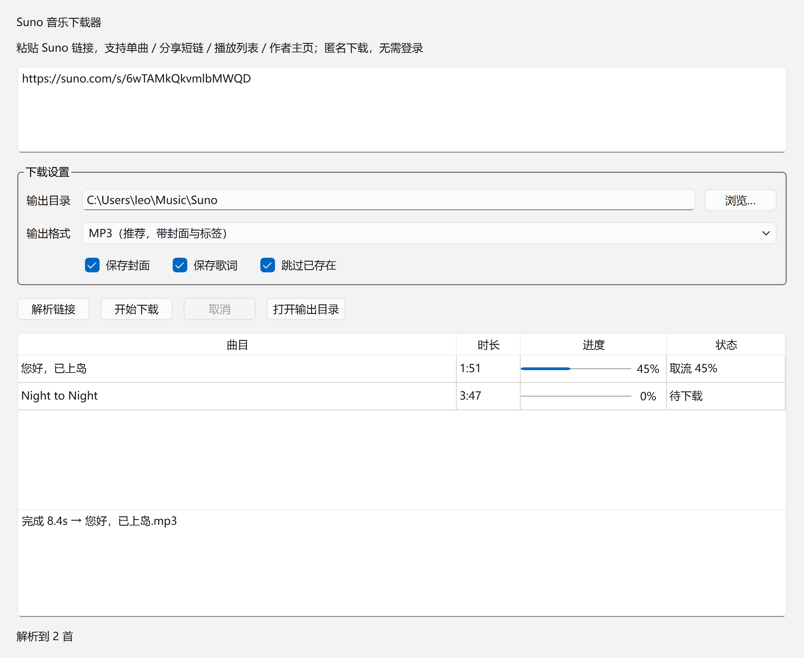

# Suno 音乐下载器

把 Suno 歌曲下载到本地 MP3 / M4A。支持**单曲、分享短链、播放列表、作者主页**四种链接，
匿名下载——**不需要登录、不需要 Cookie**，自动完成解密、转码、封面与歌词保存。

提供两种用法：图形界面（Windows 免安装的单文件 exe）和命令行。

---

## 为什么需要它

Suno 自 2026 年 8 月起把 CDN 音频改成了**静态加密**：

- 直接抓 `.m4a` 得到的是高熵密文，没有 `ftyp` / `moov` 容器结构，播放器打不开；
- 官方 `audio_url` 退化成占位符 `https://studio-api.prod.suno.com/api/forbidden`；
- `cdn1.suno.ai/<id>.mp3` 一律 403。

因此 gcui-art/suno-api 等依赖 `audio_url` 的旧工具链集体失效。

本工具走的是 **Suno 自己的 rights 通道**——网页播放器也走这一条：

```
GET  /api/clip/<id>                      取 media_urls（密文地址）
POST /api/mango/rights                   索取该曲目密钥 {key, iv, glt}（匿名听众即可获得）
     user_key = SHA256(glt)
     key / iv  → AES-GCM 解包（nonce 前 12B、tag 后 16B、AAD = clip id）
     音频本体  → AES-CTR-128 本地解密
```

解出来的就是标准 `ftypisom` 容器（Opus 编码），再用 ffmpeg 转 MP3 并内嵌封面与 ID3。
**不绕过任何付费下载额度**，只是复现网页播放器对公开内容的正常请求节奏。

---

## 快速开始

### 方式一：Windows 免安装 exe（推荐）

到 [Releases](../../releases) 下载 `SunoDownloader-x64.exe`，双击即可，不需要装 Python。

| 文件 | 大小 | 说明 |
| --- | --- | --- |
| `SunoDownloader-x64.exe` | 73 MB | 图形界面版 |
| `SunoDownloader-x64-cli.exe` | 44 MB | 命令行版，参数与下方 CLI 完全一致 |

- 适用 **Windows 10 / 11 64 位**，Qt、ffmpeg、证书库全部内置。
- 首次启动约 5–8 秒（单文件版会先解压到临时目录），之后正常。
- 若杀软误报：单文件 exe 是自解压程序，容易被启发式规则误判，改用下面的源码方式即可规避。

界面预览（200% 缩放渲染）：



### 方式二：源码运行

```bash
pip install -r requirements.txt

# 图形界面
python scripts/suno_gui.py

# 命令行
python scripts/suno_download.py "https://suno.com/s/6wTAMkQkvmlbMWQD" -o "D:\音乐" -f mp3
```

Windows 用户也可以直接双击 `启动 Suno 下载器.bat`——它会自动找 Python、自检安装依赖、拉起界面。

---

## 命令行参数

| 参数 | 说明 |
| --- | --- |
| `-o, --out` | 输出目录，默认 `./suno_downloads` |
| `-f, --format` | `mp3`（默认）/ `m4a`（原始 Opus）/ `both` |
| `--list` | 只解析并列出曲目，不下载 |
| `--skip-existing` | 跳过已存在的同名文件 |
| `--no-cover` / `--no-lyrics` | 不保存封面 / 歌词 |
| `--proxy` | 代理，如 `socks5://127.0.0.1:1080` |
| `--pause` | 两首之间的随机间隔，默认 `1.5,3.0`（秒） |

```bash
# 分享短链（最常见）
python scripts/suno_download.py "https://suno.com/s/6wTAMkQkvmlbMWQD" -o "D:\音乐"

# 整个播放列表
python scripts/suno_download.py "https://suno.com/playlist/<uuid>" -o "D:\音乐" -f mp3

# 先看有什么，再决定下不下
python scripts/suno_download.py "https://suno.com/@作者" --list
```

---

## 支持的链接

| 形态 | 示例 | 走哪个接口 |
| --- | --- | --- |
| 分享短链 | `suno.com/s/<code>` | 跟随 307 重定向解析出 song uuid |
| 单曲 | `suno.com/song/<uuid>` | `/api/clip/<uuid>` |
| 播放列表 | `suno.com/playlist/<uuid>` | `/api/playlist/<uuid>` → `playlist_clips[].clip` |
| 作者主页 | `suno.com/@<handle>` | `/api/profiles/<handle>` |
| 裸 uuid | `4d4e95e0-1fce-…` | 先当单曲，404 时按播放列表重试 |

图形界面里可以一次粘贴多行（四种类型混着来也行），程序逐条解析并去重。

---

## 能力边界

**能下载**：任何**公开可播放**的曲目。已实测：自己账号的歌 + 陌生作者的公开单曲 + 22 首的公开播放列表。

**下载不了**（会明确报错，不会假装成功）：

- 未公开 / 仅自己可见的歌曲 —— 元数据接口返回 404，报 `NotFoundError`；
- 作者主页把歌藏起来的情况 —— `/api/profiles/<handle>` 的 `clips` 可能为空，此时改用单曲或播放列表链接；
- 需要登录才能播放的内容 —— 本通道不发任何身份凭证；
- 遇到 **403 / 429** —— 抛 `BlockedError` 并**立即停止整批任务**，不做重试轰炸。

---

## 目录结构

```
.
├── scripts/
│   ├── suno_core.py       协议核心：解析链接 → 取密钥 → AES 解密 → 转码落盘
│   ├── suno_download.py   命令行入口
│   └── suno_gui.py        PySide6 / Qt6 图形界面
├── build/
│   └── make_exe.py        PyInstaller 打包脚本
├── references/
│   └── tech_notes.md      协议字段、接口清单、失败排查、变更监测点
├── 启动 Suno 下载器.bat    Windows 双击启动器
└── SKILL.md               WorkBuddy 技能描述（本仓库同时是一个 WorkBuddy Skill）
```

Suno 若再改协议，对照 `references/tech_notes.md` 里的字段样例改 `suno_core.py` 的 `decrypt()` 即可。

## 自行打包

```bash
pip install pyinstaller
python build/make_exe.py gui    # 图形界面版
python build/make_exe.py cli    # 命令行版
```

产物在 `build/dist/`。**只支持 64 位 Windows**：Qt6 / PySide6、Qt5 / PySide2、PyQt5 在 PyPI 上
都没有 win32 包（已逐个 `pip download --platform win32` 验证），32 位图形界面版做不出来。

---

## 免责声明

本项目仅用于备份**你自己创作的**、或**他人明确分享给你**的公开作品。
请勿用于批量抓取陌生创作者的内容——工具已内置 1.5–3 秒随机间隔以贴合正常播放节奏。
下载内容的版权归原作者所有，请勿二次分发。
